# thesis-formatting-skill

[中文](README.zh-CN.md)

A reusable Claude Code and GitHub Copilot skill for auditing, repairing,
rendering, and privacy-checking DOCX theses without overwriting the source
document. It turns a declarative formatting profile into reproducible DOCX,
PDF, audit, transformation, preview, and release evidence.

> [!IMPORTANT]
> **Apple University is entirely fictional. Every named person, thesis, reference,
> observation, calculation, identifier, and other data item in this repository
> is synthetic. Nothing represents a real institution, person, publication,
> student record, or source project.**

## Installation

Requires Python 3.12+, [`uv`](https://docs.astral.sh/uv/), and, for local
rendering, LibreOffice plus Poppler.

```bash
git clone https://github.com/JieGaoSunny/thesis-formatting-skill.git
cd thesis-formatting-skill
uv sync --frozen --all-extras
```

### Claude Code

Copy or symlink [`.claude/skills/thesis-formatting/`](.claude/skills/thesis-formatting/)
into the same path in a project, or into
`~/.claude/skills/thesis-formatting/` for user-wide use. The authoritative
instructions are in
[`.claude/skills/thesis-formatting/SKILL.md`](.claude/skills/thesis-formatting/SKILL.md).

### GitHub Copilot

Copy [`.github/skills/thesis-formatting/`](.github/skills/thesis-formatting/)
into the target repository. Copilot discovers
[`.github/skills/thesis-formatting/SKILL.md`](.github/skills/thesis-formatting/SKILL.md).
The root [`SKILL.md`](SKILL.md) is byte-identical to both agent-specific copies.

## Workflow

Run the following commands in order. Replace the example profile with a
reviewed profile for the document being processed; never treat the fictional
profile as universal policy.

```bash
thesis-format audit thesis.docx --profile rules/university.yaml --report reports/audit.json --markdown reports/audit.md
thesis-format format thesis.docx --profile rules/university.yaml --output build/thesis-formatted.docx --report reports/transformation.json
thesis-format export build/thesis-formatted.docx --output build/thesis-formatted.pdf --manifest reports/render-manifest.json
thesis-format preview build/thesis-formatted.pdf --manifest reports/render-manifest.json --output-dir reports/preview
thesis-format release-check build/thesis-formatted.docx --profile rules/university.yaml --report reports/privacy.json
```

`audit` diagnoses; `format` writes a new DOCX and content-comparison evidence;
`export` creates a PDF and render manifest; `preview` creates review images;
`release-check` scans the release set. Exit codes are `0` for success, `1` for
findings or incomplete validation, and `2` for invalid input or tooling.

For local development only, set `THESIS_RENDER_MODE=local` and pass
`--allow-noncanonical` to `export`. Such output is explicitly noncanonical and
must not be used as publication or compliance evidence.

## Examples

The committed demonstration provides separate downloadable artifacts:

- Before: [DOCX](examples/before.docx) · [PDF](examples/before.pdf) ·
  [audit](examples/reports/before-audit.md)
- After: [DOCX](examples/after.docx) · [PDF](examples/after.pdf) ·
  [audit](examples/reports/after-audit.md) ·
  [transformation report](examples/reports/after-transformation.json)
- Preservation evidence:
  [content comparison](examples/reports/content-diff.md)

The PDFs and screenshots are local-mode demonstrations, not canonical release
artifacts.

### Matched before/after screenshots

| Destination | Before | After |
|---|---|---|
| Cover | 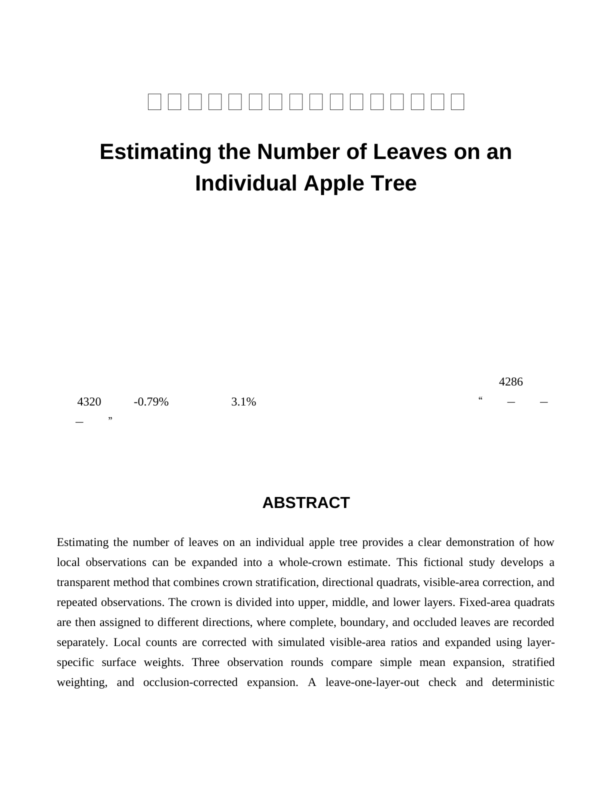 | 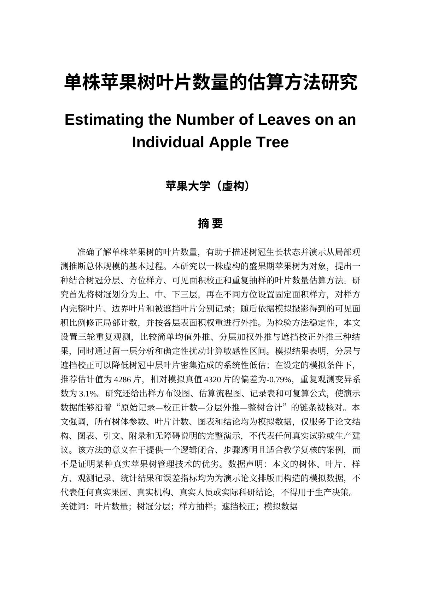 |
| Table of contents | 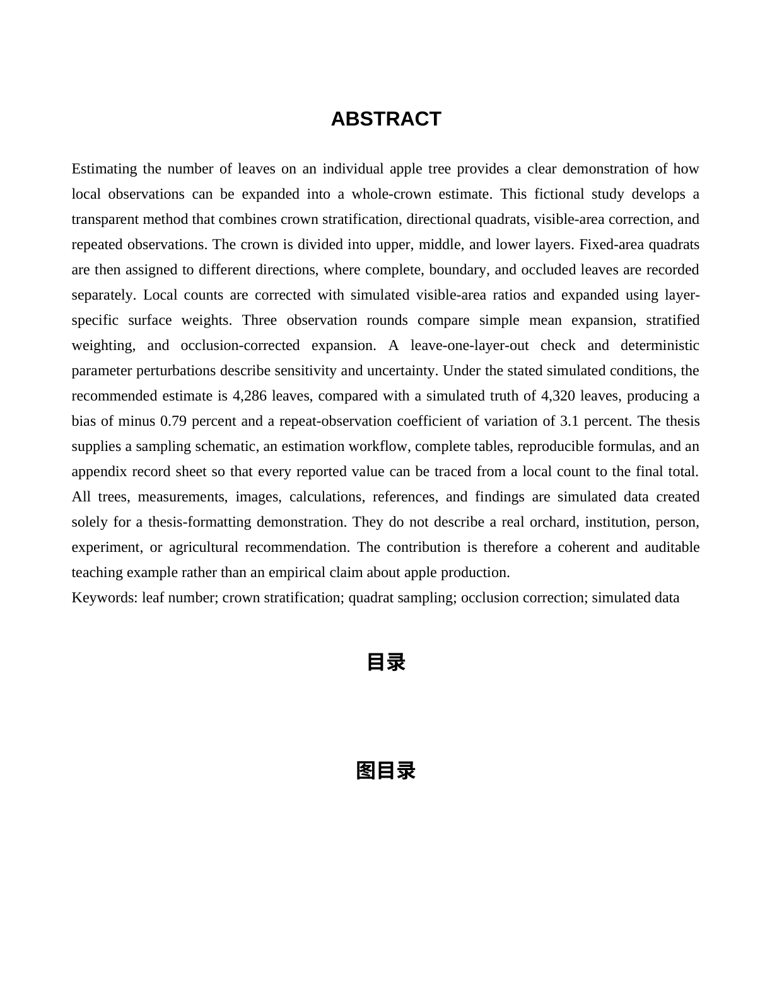 | 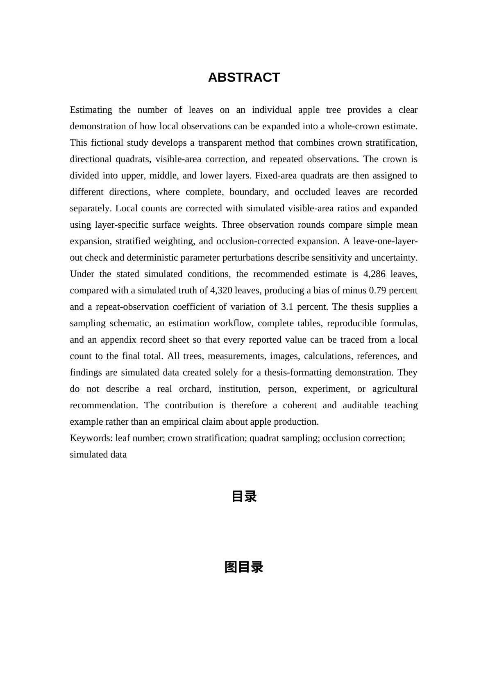 |
| Body | 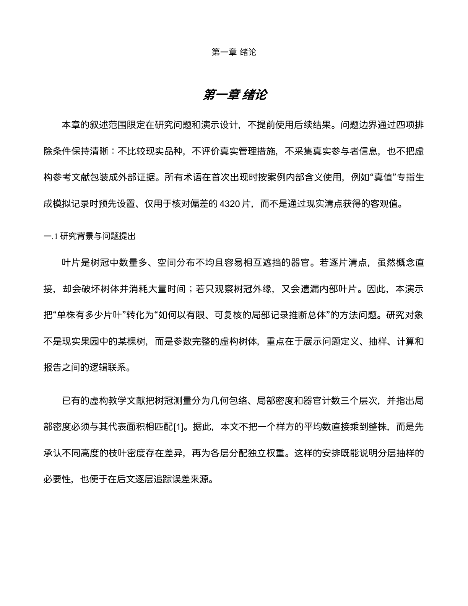 | 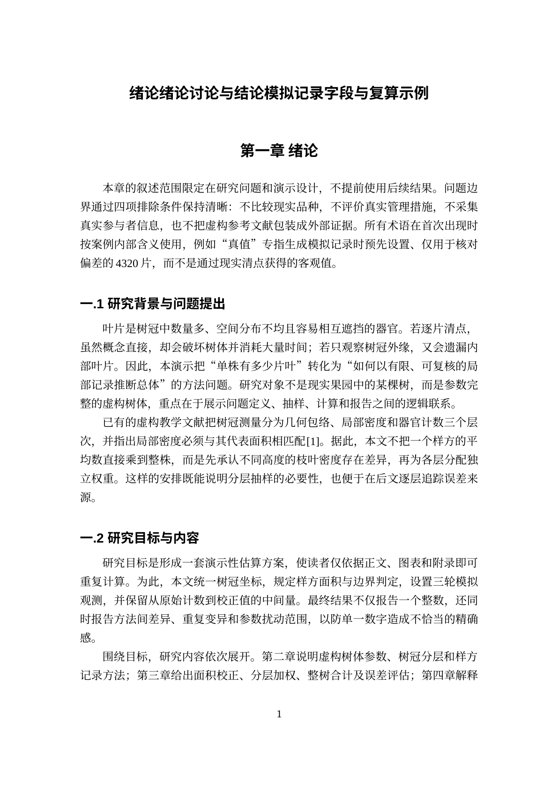 |
| Figure | 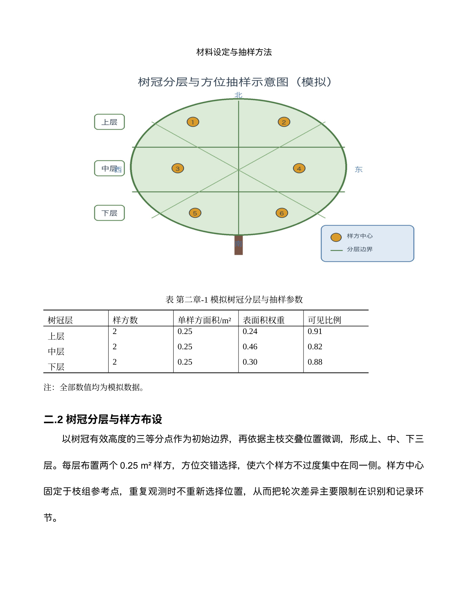 | 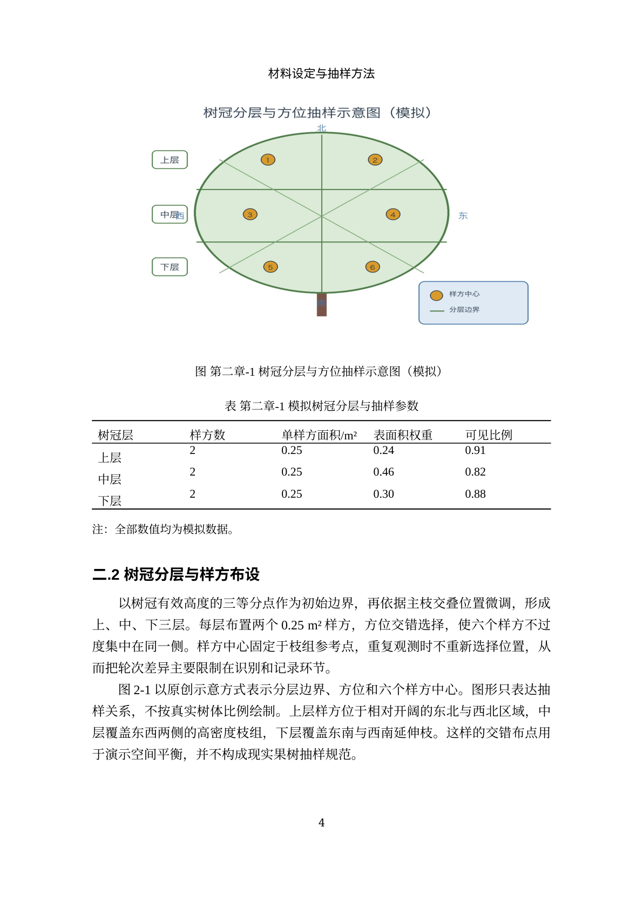 |
| Table |  |  |
| References | 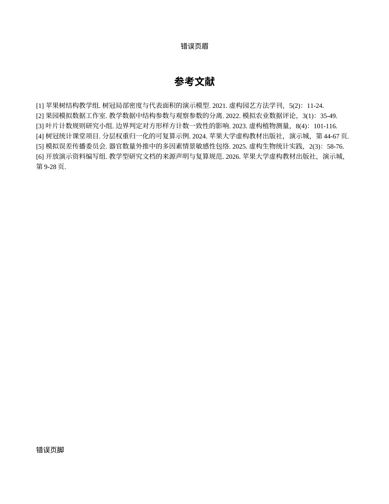 | 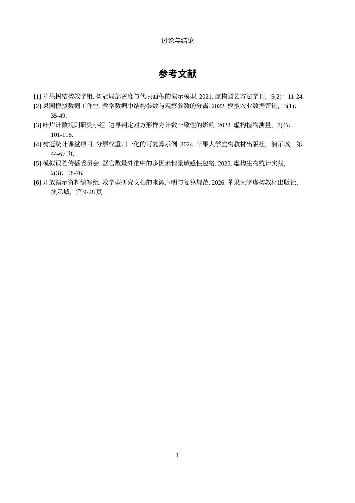 |
| Appendix | 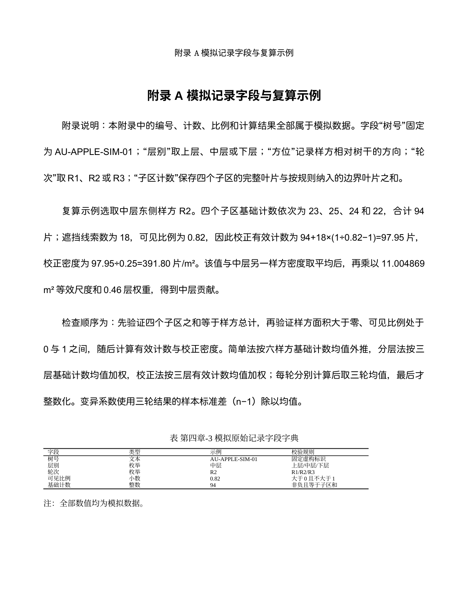 | 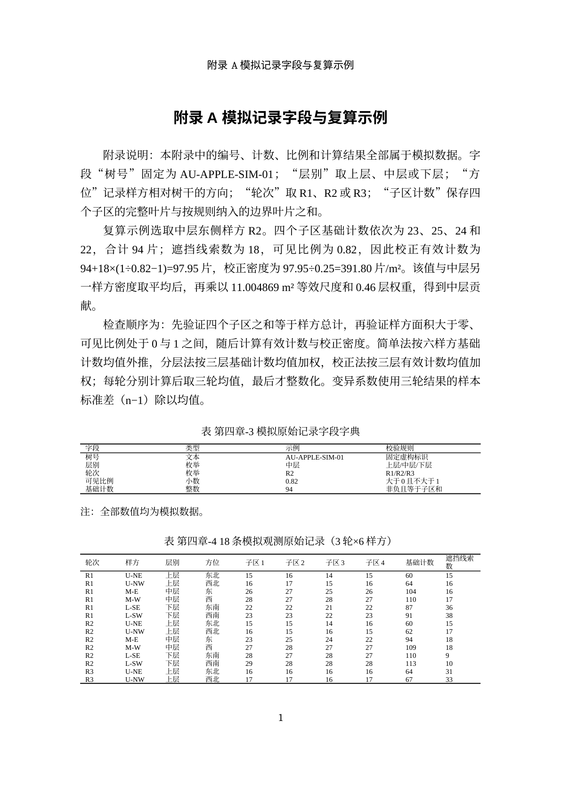 |

## Repaired defects

The synthetic “before” document deliberately exercises these repairs:

| Area | Demonstrated defect | Deterministic repair |
|---|---|---|
| Page layout | Wrong paper, margins, and section start | Apply profile geometry and section policy |
| Styles | Incorrect definitions, mappings, and direct formatting | Resolve semantic roles and apply declared styles |
| Headings/TOC | Manual chapter numbering and missing TOC field | Restore automatic numbering and field structure |
| Headers/footers | Wrong source, links, and page-number fields | Rebuild section-aware stories without dropping content |
| Figures | Oversized figure and caption below/away from object | Constrain width and bind/move the unique caption |
| Tables | Non-three-line borders, no repeated header, split rows | Apply border, repeat, and row-splitting rules |
| References | Inconsistent indentation and spacing | Normalize reference paragraph formatting |

See the anonymous rule guide in [`docs/format-rules.md`](docs/format-rules.md).

## Architecture

```text
format profile ──> semantic OOXML inventory ──> audit findings
                         │
source DOCX ─────────────┴──> deterministic formatter ──> new DOCX
       │                                      │
       └──────── content snapshot comparison ─┘
new DOCX ──> pinned renderer ──> PDF + manifest ──> matched previews
release set ──> fail-closed privacy scanner ──> JSON/Markdown release report
```

The semantic layer records paragraphs, fields, bookmarks, tables, figures,
sections, headers, footers, notes, and equations. Ambiguous evidence remains
ambiguous. The formatter uses focused repair modules for geometry, styles,
numbering, fields, objects, and headers/footers. JSON schemas validate every
public report contract.

## Tests and reproducibility

```bash
uv sync --frozen --all-extras
uv run --frozen pytest -m "not integration"
uv run --frozen pytest
```

The full suite includes external-renderer integration tests when LibreOffice
and Poppler are available. CI installs exactly from [`uv.lock`](uv.lock), checks
documentation links, runs unit tests outside the container, then runs render
and end-to-end demo tests inside the canonical image.

Canonical renderer image (exact immutable digest):

```text
ghcr.io/jiegaosunny/thesis-formatting-skill-render@sha256:5866364e94961d3e8f33402985f4b2e900febb07a7503e83b8c957216c1c9d79
```

Pull it exactly:

```bash
docker pull ghcr.io/jiegaosunny/thesis-formatting-skill-render@sha256:5866364e94961d3e8f33402985f4b2e900febb07a7503e83b8c957216c1c9d79
docker run --rm \
  -e THESIS_RENDER_IMAGE_DIGEST=sha256:5866364e94961d3e8f33402985f4b2e900febb07a7503e83b8c957216c1c9d79 \
  ghcr.io/jiegaosunny/thesis-formatting-skill-render@sha256:5866364e94961d3e8f33402985f4b2e900febb07a7503e83b8c957216c1c9d79 \
  --version
```

Canonical mode verifies the root-owned container marker, source/build inputs,
image digest, LibreOffice version, fonts, locale, and PDF hash. Merely setting
`THESIS_RENDER_IMAGE_DIGEST` on another host cannot make a render canonical.

## Limitations and manual review

Automation does not decide whether ambiguous text is a heading, verify the
scholarly correctness of citations, judge visual quality, or approve a thesis.
Review every warning, skipped repair, page break, field result, formula, figure,
table, reference, and appendix in Word and in the rendered PDF. Platform font
substitution can change pagination. See
[`docs/limitations.md`](docs/limitations.md) for the complete checklist.

## Privacy

The release check scans visible and hidden DOCX text, OOXML attributes,
relationships, properties, embedded filenames, PDF text/metadata, paths,
identity-shaped values, unresolved placeholders, and optional literal denylist
entries. Findings are redacted in reports and command output. Unreadable or
malformed in-scope content fails closed.

CI uses only the public synthetic fixture
[`tests/fixtures/privacy/synthetic-denylist.txt`](tests/fixtures/privacy/synthetic-denylist.txt);
it needs no organization-specific denylist or secret. For real work, keep any
additional local denylist outside version control and pass it with
`--denylist`.
